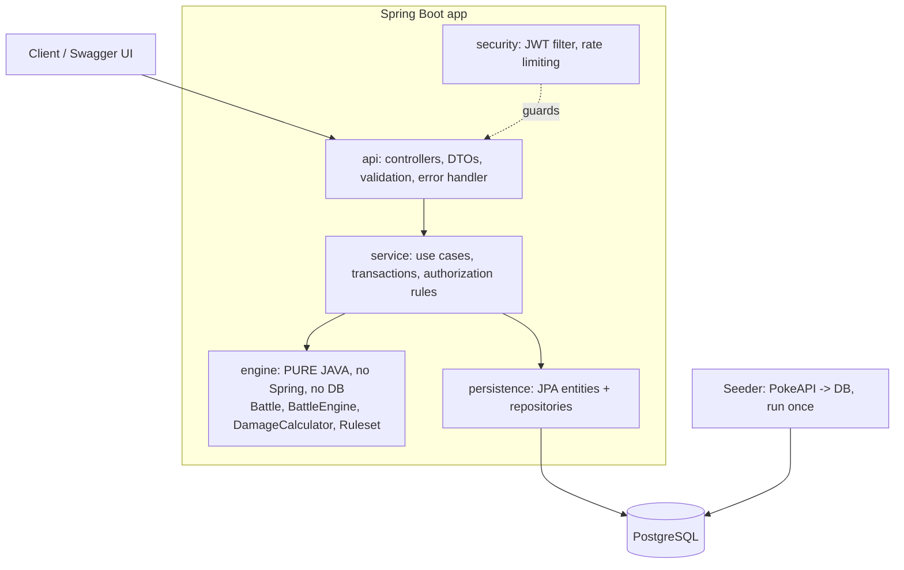
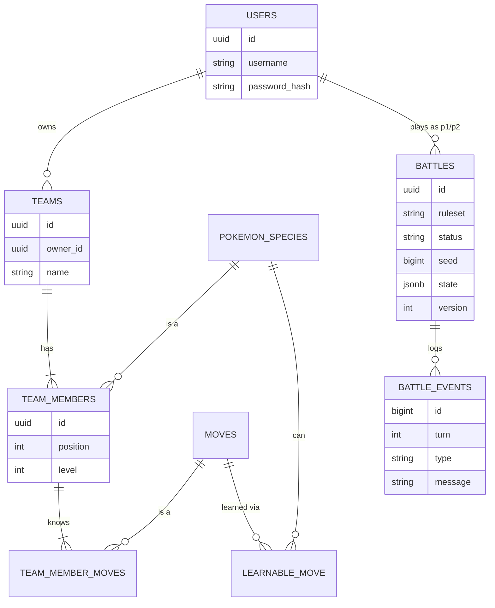

# Architecture

## Layers

Dependency rule: arrows point inward. `engine` imports nothing from the rest of the app, so the
hardest logic is unit-testable in milliseconds and reusable.

## Supporting several generations

Two separate concerns, kept separate on purpose:

| Concern | Where it lives | Gen 1 now | Later |
|---|---|---|---|
| **Mechanics** (type chart, damage formula, crit rate, status rules) | `Ruleset` implementations | `Gen3Rules` (FireRed) | `Gen4Rules`, ... |
| **Content** (species, moves, learnsets) | DB rows tagged with `generation` / `version_group` | 151 species | insert more rows |

A battle stores which ruleset it uses. FireRed = Gen 3 mechanics + Kanto roster, which is why the ruleset is
not simply "gen 1". PokeAPI note: use each species' `past_types` so Clefairy is Normal (not Fairy) in this game.

## Data model

- `battles.state` is the serialized `Battle` (jsonb). Each team is snapshotted into the battle so later team
  edits never change a battle in progress.
- `battles.version` is the optimistic-locking column. Two simultaneous action submissions: one wins, the other gets 409.
- `battles.seed` + the action history means any battle can be replayed exactly.

## Endpoints (planned, `/api/v1`)

| | Endpoint | Auth |
|---|---|---|
| Auth | `POST /auth/register`, `POST /auth/login` | public |
| Dex | `GET /species`, `GET /species/{dex}`, `GET /moves`, `GET /moves/{id}` (paginated, filterable) | public |
| Teams | `POST /teams`, `GET /teams`, `GET/PUT/DELETE /teams/{id}` | JWT |
| Battles | `POST /battles`, `POST /battles/{id}/join`, `GET /battles/{id}`, `POST /battles/{id}/actions`, `POST /battles/{id}/replacement`, `GET /battles/{id}/events` | JWT |
| Demo | `POST /simulate` runs a full random battle and returns the log | public, rate-limited |
| Ops | `GET /actuator/health` | public |

## Battle turn flow

1. Both players `POST /actions` (move or switch). The first is stored as pending; the second triggers resolution.
2. Engine order: switches, then moves by priority then speed (ties random), then burn/poison damage, then faint check.
3. A faint moves the battle to `AWAITING_REPLACEMENT`; the owner calls `/replacement`. All fainted = `FINISHED`.

## Current simplifications (documented, deliberate)

No abilities, held items, natures/IV/EV customization, stat stages, weather, or multi-turn moves yet. Level fixed per team;
IV 31 / EV 0 / neutral nature. Sleep lasts 1-4 lost turns, then the Pokemon wakes and acts the same turn.
Only moves that are pure damage or inflict a status are seeded (PokeAPI `meta.category`).
